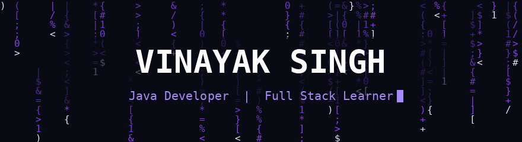
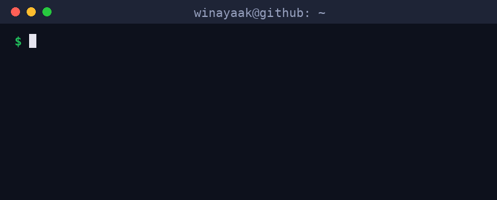

 

  

---

## 👋 About Me

Hi, I'm **Vinayak Singh**, a Computer Engineering student from **Mumbai, India**, passionate about building real-world software.

- 🎓 B.E. Computer Engineering
- 💻 Java Developer | Full Stack Learner
- 🚀 Currently building: ERP systems & web apps
- 🎯 Target: Software Developer roles (Haptik / fintech companies)
- 📍 Mumbai, India

---

## 🌱 Currently Learning

`Spring Boot` · `React` · `Node.js` · `Express` · `MongoDB` · `REST APIs` · `Data Structures & Algorithms`

---

## 🛠️ Tech Stack

**Languages**

**Backend & Frameworks**

**Databases**

**Tools & DevOps**

> 🟣 Learning next: Docker · PostgreSQL · JWT / Spring Security · AWS basics

---

## 📂 Featured Projects

<table>
<tr>
<td width="50%" valign="top">

### 🏫 Student Management ERP
A full college ERP: students, attendance, exams, fees, library and hostel.

- 🔐 Session-based auth with an auth filter
- 🔑 SHA-256 password hashing
- 🧱 DAO pattern + `PreparedStatement` queries
- ⚠️ Rule-based **academic risk detector**

`Java` `JSP` `Servlets` `JDBC` `MySQL` `MVC2`

</td>
<td width="50%" valign="top">

### 📦 Import Export ERP
An ERP-style system for managing import/export operations end to end.

- ☕ Java + JDBC backend
- 🗄️ MySQL data layer
- 🌐 Full-stack web flow

`Java` `JDBC` `MySQL`

</td>
</tr>
<tr>
<td width="50%" valign="top">

### 🌤️ WeatherX
A real-time weather app that pulls live data from the OpenWeather API.

- ⚡ Async fetch with real-time data
- 🎨 Clean responsive UI

`JavaScript` `HTML` `CSS` `OpenWeather API`

</td>
<td width="50%" valign="top">

### 🤖 SAViR AI (in development)
Final-year capstone: an AI platform that assesses, verifies and tracks developer skills.

- 🧠 AI mentor + skill-gap analysis
- 🔗 GitHub evidence for skill proof
- 🐳 Sandboxed code execution

`React` `Spring Boot` `PostgreSQL` `FastAPI` `Docker`

</td>
</tr>
</table>

---

## 📊 GitHub Stats

 

### 🔥 Contribution Graph

  

<picture>
  <source media="(prefers-color-scheme: dark)" srcset="https://raw.githubusercontent.com/winayaak/winayaak/output/github-snake-dark.svg" />
  <source media="(prefers-color-scheme: light)" srcset="https://raw.githubusercontent.com/winayaak/winayaak/output/github-snake.svg" />
  
</picture>

---

## 📫 Contact

