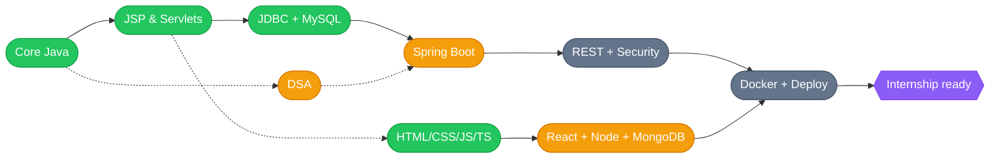

<!-- ============================================================
  Profile README for github.com/winayaak
  Repo name must be exactly: winayaak/winayaak  (public)
============================================================ -->

<div align="center">


<a href="https://git.io/typing-svg">
  
</a>

<br/>

<a href="mailto:vinayak190804@gmail.com"></a>
<a href="https://www.linkedin.com/in/vinayak-singh-1b752a288"></a>
<a href="https://github.com/winayaak"></a>

<br/><br/>


</div>

---

## 👋 About me

```java
public class Vinayak {

    String name      = "Vinayak Singh";
    String degree    = "B.E. Computer Engineering (Final Year), University of Mumbai";
    String location  = "Mumbai, India";
    String training  = "SDAC Infotech, Borivali (Java + MERN)";
    String[] now     = { "Spring Boot", "React", "Node.js", "MongoDB", "DSA" };
    String lookingFor = "Software developer internship / entry-level role";

    public String motto() {
        return "Small, useful work over vague claims.";
    }
}
```

- 🎓 Final-year Computer Engineering student, learning the **Java backend → full-stack** path properly instead of skimming it
- 🔭 Currently building **SAViR AI**: an AI-powered developer skill assessment and verification platform (final-year capstone, team of 3)
- 🌱 Learning in public: Core Java → JSP/Servlets → **Spring Boot**, plus the **MERN** stack and **DSA** alongside
- 🎯 Looking for a **software developer internship** where I can ship real code and get reviewed hard
- 📫 Fastest way to reach me: **[email](mailto:vinayak190804@gmail.com)** or **[LinkedIn](https://www.linkedin.com/in/vinayak-singh-1b752a288)**

---

## 🧰 Tech stack

### ✅ What I've worked with

<div align="center">


</div>

| Area | What I've covered |
|---|---|
| **Core Java** | OOP, String / StringBuilder / StringBuffer, abstract classes & interfaces, exception handling, Collections (`ArrayList`, `HashMap`, `HashSet`, `LinkedList`) |
| **Java web** | JSP (scriptlets, expressions, declarations), Servlets, JDBC, MVC2 architecture |
| **Databases** | MySQL, SQL fundamentals |
| **Frontend** | HTML5, CSS3, JavaScript (ES6+, async/await, DOM manipulation), TypeScript basics |
| **Tools** | Git, GitHub, VS Code, IntelliJ IDEA |

### 🚧 Learning right now

<div align="center">


</div>

`Spring Boot` · `React` · `Node.js` · `Express` · `MongoDB` · `JSTL` · `Data Structures & Algorithms`

### 🎯 Up next (what the job market actually asks for)

<div align="center">


</div>

`REST API design` · `JWT / Spring Security` · `PostgreSQL` · `Docker` · `Postman` · `JUnit` · `Linux basics` · `AWS fundamentals` · `System design basics`

---

## 🗺️ My learning roadmap



> 🟢 done &nbsp;·&nbsp; 🟠 in progress &nbsp;·&nbsp; ⚪ upcoming

---

## 🚀 Featured projects

<table>
  <tr>
    <td width="50%" valign="top">

### 🎓 [Integrated Student Management System](https://github.com/winayaak/Integrated-Student-Management-System)
A web-based college ERP covering students, attendance, exams, fees, library and hostel.

`Java` `JSP` `Servlets` `JDBC` `MySQL` `MVC2`

    </td>
    <td width="50%" valign="top">

### 📦 [Import-Export ERP System](https://github.com/winayaak/Import-Export-Erp-system)
An ERP-style system for managing import/export operations, built in Java.

`Java` `MySQL`

    </td>
  </tr>
  <tr>
    <td width="50%" valign="top">

### 🌦️ [WeatherX](https://github.com/winayaak/WeatherX)
A weather app that fetches live data from an API and renders it in the browser.

`JavaScript` `HTML` `CSS` `REST API`

    </td>
    <td width="50%" valign="top">

### 🤖 SAViR AI &nbsp;<sub>(in development)</sub>
Final-year capstone: an AI platform to assess, verify and track developer skills, with GitHub evidence and explainable scoring.

`React` `Spring Boot` `PostgreSQL` `FastAPI` `Docker`

    </td>
  </tr>
</table>

---

## 📊 GitHub stats

<div align="center">


<br/>


<br/>


</div>

### 🐍 Contribution snake

<div align="center">

<picture>
  <source media="(prefers-color-scheme: dark)" srcset="https://raw.githubusercontent.com/winayaak/winayaak/output/github-snake-dark.svg" />
  <source media="(prefers-color-scheme: light)" srcset="https://raw.githubusercontent.com/winayaak/winayaak/output/github-snake.svg" />
  
</picture>

</div>

---

## 🎯 2026 goals

- [x] Core Java: OOP, Strings, Exceptions, Collections
- [x] JSP, Servlets, JDBC, MVC2 and two ERP-style projects
- [ ] Finish JSTL + JSP/Servlet MVC flow
- [ ] Build and ship a **Spring Boot** REST API with JWT auth
- [ ] Build a **MERN** project and deploy it
- [ ] Solve DSA problems consistently
- [ ] Containerize a project with **Docker**
- [ ] Land a **software developer internship** 🚀

---

## 🤝 Let's connect

<div align="center">

I'm happy to talk about Java, backend, internships, or collaborating on something small and useful.

<a href="mailto:vinayak190804@gmail.com"></a>
<a href="https://www.linkedin.com/in/vinayak-singh-1b752a288"></a>

<br/><br/>

<sub>⭐ If something here is useful, a star on the repo means a lot.</sub>


</div>
